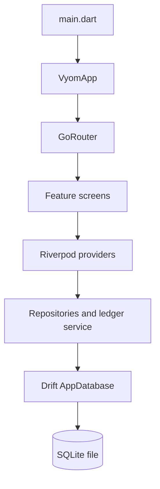

# Project Handover

This document describes the checked-out working tree of VYOM Intelligent 2 as audited on 2026-10-28. It is based on source code, tests, local tool output, and current Git metadata. It is not an approved product roadmap.

## 1. Project Summary

VYOM is intended for small delivery businesses that maintain recurring customer orders, distribute products daily, collect or issue payments, and need customer balances. The current application is an offline-first Flutter client with local SQLite persistence. The final product goal is broader than the current implementation: dependable monthly billing, invoices, reporting, operational integrations, backup/security, and a release process are still required.

The current working tree contains the core offline data model and workflows through customer ledger reporting. Git status is dirty and includes generated and uncommitted project files; this document describes the working tree, not only the latest commit.

## 2. Current Implementation Status

| Feature | Status | Relevant files | What currently works | What's missing | Verification needed |
|---|---|---|---|---|---|
| Flutter foundation and onboarding | Implemented | `lib/main.dart`, `lib/app/app.dart`, `lib/features/onboarding/` | ProviderScope startup, splash routing, language selection, persisted onboarding flag, profile gate | Full localization and robust recovery UX | Platform smoke tests |
| Business profile | Implemented | `lib/database/business_profile_repository.dart`, `lib/features/business_setup/` | Save/read/update one profile | Validation and multi-company decisions are limited | More validation/widget coverage |
| Product management | Implemented | `lib/database/product_repository.dart`, `lib/features/products/` | Active product list, create/update/deactivate, duplicate active-name guard | Complete price administration UI is not evident | UI and pricing workflow review |
| Customer management | Implemented | `lib/database/customer_repository.dart`, `lib/features/customers/` | Create/update/deactivate, active list, mobile/name validation | Search, import, route-level edit coverage | Broader widget tests |
| Customer-product assignments | Implemented | `lib/database/customer_product_repository.dart`, customer screens | Assign/update/remove default quantities with unique pair guard | UX and quantity validation need review | Edge-case UI tests |
| Daily distributions | Implemented | `lib/database/daily_distribution_repository.dart`, `lib/features/daily_distribution/` | Draft save, atomic batch operations, confirmation, confirmed read-only behavior | Missed-delivery reporting and correction policy | Version 4/5 migration and platform checks |
| Historical pricing | Implemented | `lib/database/product_pricing_repository.dart`, `product_pricing_provider.dart` | Effective periods, overlap validation, current/date lookup | Complete pricing administration UI is not evident | Verify all callers use intended provider |
| Price snapshots | Implemented | `lib/database/app_database.dart`, `daily_distribution_repository.dart` | Confirmation stores unit and line amounts; historical charges remain stable | Repair/reconciliation policy for malformed old rows | Migration and corrupted-data tests |
| Transactions | Implemented | `lib/database/transaction_repository.dart`, `lib/features/transactions/` | RECEIVED/GIVEN, cash/UPI/bank, notes, date filtering, update/delete | Audit trail and authorization do not exist | End-to-end edit/delete checks |
| Customer ledger summary | Implemented | `lib/database/customer_ledger_service.dart`, `lib/features/reports/customer_ledger_screen.dart` | Date-range totals and historical-customer inclusion | Export and broader reporting | UI tests with all entry types |
| Customer ledger detail | Implemented | `lib/database/customer_ledger_service.dart`, `lib/features/reports/customer_ledger_detail_screen.dart` | Chronological entries, DR/CR, notes, running balance, empty state | Opening/closing balance policy and export | Verify tie ordering and historical edge cases |
| Dashboard navigation | Partially implemented | `lib/features/dashboard/dashboard_screen.dart`, `lib/app/router.dart` | Cards and routes are wired for core areas | End-to-end behavior is not covered by a dashboard integration test | Manual smoke test every card |
| Monthly billing/invoices | Planned | No invoice modules found | No verified implementation | Billing periods, immutable invoices, corrections, reissue | Product/accounting decisions first |
| Export, printing, WhatsApp, sync, licensing | Planned | No integration modules found | No verified implementation | External integration architecture and credentials | Platform/vendor spike |

## 3. Completed Implementation

### Application foundation, navigation, and dashboard

`lib/main.dart` starts `VyomApp` inside a Riverpod `ProviderScope`. `lib/app/app.dart` configures Material 3 and `go_router`; `theme.dart` defines the teal seeded light theme. `router.dart` contains onboarding, setup, dashboard, management, transaction, and report routes. The dashboard provides cards for Customers, Daily Update, Transactions, and Reports, plus app-bar links to profile and products.

The route list exists in source, but every dashboard action should be manually smoke-tested before release because route wiring and feature completeness are separate concerns.

### Products, customers, and assignments

`ProductRepository` trims required fields, rejects empty values, prevents duplicate active product names case-insensitively, and deactivates instead of deleting. `CustomerRepository` trims name/address, strips non-digits from the mobile number, requires ten digits, and preserves deactivated rows. `CustomerProductRepository` enforces one assignment per customer/product and stores an integer default quantity.

The UI lives under `lib/features/products/` and `lib/features/customers/` and uses Riverpod providers to invalidate lists after mutations.

### Daily distribution

`DailyDistributionRepository` normalizes business dates to UTC midnight and stores one customer/date distribution. It supports draft save, item add/update/remove, batch save, batch confirmation, and deletion of drafts. Batch writes are wrapped in Drift transactions. Duplicate customers in a batch and duplicate products within a distribution are rejected. Confirmed rows cannot be changed or deleted. The screen enters read-only mode for confirmed data.

The batch-save path permits zero quantities so a full customer/product matrix can be preserved. Standalone `createDistributionWithItems` requires positive quantities and non-empty items; callers must understand this API distinction.

### Historical pricing and snapshots

`ProductPricingRepository` stores non-overlapping effective periods. Prices are integer paise per base unit, dates are UTC calendar dates, and an open-ended period is represented by a null `effectiveTo`. The repository prevents negative prices, invalid ranges, overlap, and multiple open-ended periods.

At confirmation, `DailyDistributionRepository` obtains the price effective on the distribution date and stores `unitPricePaise` and `lineAmountPaise` on the distribution item. Zero quantity snapshots to zero. A missing price prevents confirmation. The ledger reads the stored line amount; it must never derive a historical charge from the current product price.

### Transactions and ledger

`TransactionRepository` parses rupees with at most two decimal places into integer paise, normalizes transaction dates, validates positive amounts and existing customers, and stores optional trimmed notes. `received` is a credit; `given` is a debit. The transaction UI supports creating, listing, editing, and deleting records.

`CustomerLedgerService` is the accounting source of truth. It includes only confirmed distributions, adds GIVEN amounts to debit, adds RECEIVED amounts to credit, includes historical records for deactivated customers, and validates date ranges. `calculateCustomerLedgerEntries` returns distribution and transaction entries sorted chronologically. The summary and detail screens consume that service through Riverpod providers.

### Quantity conversion and tests

`lib/utils/quantity_converter.dart` converts human quantities to integer base units and back. Litre/kg-style units use a 1000 multiplier; piece/gram-style units use a 1 multiplier according to the helper's unit mapping.

The repository has focused tests for repositories, pricing snapshots, ledger rules, quantity conversion, daily-screen helpers, and onboarding/ledger widgets.

## 4. Business Rules and Data Integrity

- **Draft versus confirmed:** drafts are editable and do not contribute to the ledger. Confirmation requires items and freezes the distribution.
- **Zero quantity:** batch daily entry can retain zero-quantity items. On confirmation their snapshot amount is zero and they do not create a ledger debit entry.
- **Historical price:** price periods use `[effectiveFrom, effectiveTo)` semantics. Confirmed rows retain price and line-amount snapshots.
- **Ledger:** balance is `debitPaise - creditPaise`; distributions and GIVEN transactions are debit, RECEIVED transactions are credit. Negative balances are possible.
- **Precision:** persisted money is integer paise. Quantity is integer base units. The transaction parser currently uses `double` only while converting a validated rupee string; persisted and ledger values remain integers.
- **Dates:** distribution, transaction, price, and ledger range boundaries are normalized to UTC midnight.
- **Foreign keys:** Drift references customers/products/distributions, and `PRAGMA foreign_keys = ON` is enabled before opening the database.
- **Uniqueness:** customer/product, customer/date distribution, distribution/product, and product/effective-from combinations are unique.
- **Corrections/deletion:** products and customers are deactivated; drafts may be deleted; confirmed distributions are protected; transactions and price entries can be updated/deleted. There is no audit log or immutable correction workflow yet.

Unresolved decisions include whether confirmed deliveries may ever be reversed, how invoice corrections should be represented, whether transaction deletion needs an audit trail, and whether a ledger range should carry an opening balance from earlier periods.

## 5. Architecture and Code Map



`database_providers.dart` creates the shared `AppDatabase` provider and wires repositories. Screens are mostly `ConsumerWidget` or `ConsumerStatefulWidget` and invalidate providers after writes. Repositories own persistence and validation; the ledger service owns cross-table financial aggregation. Drift maps the Dart table declarations to generated data classes and companions in `app_database.g.dart`.

## 6. Local Setup and Verification

From the repository root:

```powershell
flutter pub get
dart run build_runner build
dart format lib test
flutter analyze
flutter test
```

The exact sequence was executed on 2026-10-28 with Flutter 3.47.1 and Dart 3.13.1. It completed successfully: code generation succeeded, analysis reported no issues, and 172 tests passed. Existing Drift warnings report multiple in-memory database instances in some tests; they are warnings only.

Android configuration exists under `android/`, including Kotlin/Java 17 compile settings and the default `com.example.vyom_business` application ID. The local environment lacks an Android SDK, so `flutter build apk` has not been verified. Windows desktop configuration exists, but Visual Studio with C++ is not installed locally. Chrome is available; web-specific behavior is not covered by the test suite.

## 7. Test Inventory and Quality Status

| Test file | Coverage |
|---|---|
| `business_profile_repository_test.dart` | Business profile persistence |
| `customer_ledger_test.dart` | Summary/detail ledger calculations and accounting rules |
| `customer_management_test.dart` | Customer and assignment workflows/widgets |
| `daily_distribution_repository_test.dart` | Drafts, batches, confirmation, constraints, rollback, migrations |
| `daily_distribution_screen_test.dart` | Zero filtering, totals, confirmation helper behavior |
| `historical_pricing_regression_test.dart` | Snapshot immutability, draft exclusion, effective-date pricing |
| `product_management_test.dart` | Product management behavior |
| `product_pricing_test.dart` | Pricing CRUD, date ranges, overlap validation |
| `products_customers_repository_test.dart` | Product/customer/assignment repository behavior |
| `quantity_converter_test.dart` | Parsing, formatting, rejection, round trips |
| `transaction_repository_test.dart` | Transaction CRUD, parsing, dates, migrations |
| `widget_test.dart` | Language selection and ledger summary/detail widgets |

The earlier documentation task recorded 172 passing tests. A fresh `flutter test` run during this audit also passed 172 tests; it is separate from earlier conversational test counts. A fresh `flutter analyze` run also reported no issues. There are no documented integration, golden, accessibility, performance, or platform-release tests. Drift's multiple-database warnings remain a known test-harness issue.

## 8. Remaining Work

The following are candidate product requirements, not evidence of an approved roadmap. Their status is based on the checked-out source:

- **Monthly billing/invoices:** no invoice tables, service, or screens found. Design monthly periods, immutable invoice snapshots, corrections, and reissue behavior before implementation.
- **Invoice history/export/PDF/printing:** no invoice export or PDF/printing module found. Bluetooth printing is also absent.
- **WhatsApp:** no messaging client, delivery status, or integration settings found.
- **Missed-delivery reports:** no dedicated report found; daily distribution data exists as a foundation.
- **Voice commands:** no speech/voice dependency or feature found.
- **Hindi/English:** language choice is persisted, but strings are mostly hard-coded English and no localization resource system is present.
- **Suppliers/purchases and Excel import:** no related tables, repositories, or screens found.
- **Reporting/export:** ledger summary/detail exists; general exports and operational reports are absent.
- **Online sync/conflict handling:** no backend, API, sync queue, or conflict model found.
- **Licensing/admin limits/OTP:** no licensing, expiry, device limit, or OTP implementation found.
- **Backup/restore/security/production errors:** no backup workflow, authentication, encryption policy, audit log, crash reporting, or structured error telemetry found.
- **Release validation:** Android and Windows builds need a configured machine; signing and store/release configuration are not established.

Additional gaps are a formal invoice/accounting policy, auditability of edits and deletions, opening-balance semantics, robust schema migration coverage for all current versions, and complete route/UI smoke coverage.

## 9. Proposed Roadmap

This is a proposed dependency-ordered roadmap, not an existing milestone plan.

### Phase A: Stabilize the offline core

- **Objective:** make current workflows reliable and release-testable.
- **Tasks:** reconcile generated Drift output, add migration tests for versions 4 and 5, validate dashboard routes, improve transaction/price UI coverage, and decide audit/deletion behavior.
- **Likely files:** `app_database.dart`, repositories, providers, feature screens, `test/`.
- **Dependencies:** current schema and business rules.
- **Acceptance:** clean generation/analyze/tests; migration tests preserve data; manual smoke flow passes from onboarding through ledger.
- **Tests:** migration, repository edge cases, widget smoke tests.
- **Risks:** changing schema or confirmed-record behavior can invalidate financial history.

### Phase B: Monthly billing and invoice domain

- **Objective:** turn confirmed deliveries and transactions into dependable monthly statements/invoices.
- **Tasks:** define billing period and opening balance, add invoice header/line snapshots, immutable issue state, corrections/voids, reissue rules, and invoice history.
- **Likely files:** new invoice tables/repositories/services/screens and `app_database.dart` migrations.
- **Dependencies:** ledger invariants, historical snapshots, audit policy.
- **Acceptance:** a closed period reproduces the same invoice after price or product changes; corrections are explicit and traceable.
- **Tests:** period boundaries, rounding, reissue, deactivated customers, migrations, and regression against ledger totals.
- **Risks:** unresolved accounting decisions and schema migration complexity.

### Phase C: Offline reports and document output

- **Objective:** give operators usable statements and invoices without a server.
- **Tasks:** add missed-delivery/monthly reports, export formats, PDF layout, print abstraction, and optionally Bluetooth printer support.
- **Likely files:** report/export services, invoice screens, platform adapters.
- **Dependencies:** stable invoice model and supported target platforms.
- **Acceptance:** exported documents match stored invoice snapshots and work without network access.
- **Tests:** deterministic document data, boundary dates, and platform/manual print checks.
- **Risks:** printer/PDF vendor compatibility and regional formatting.

### Phase D: Localization and operational integrations

- **Objective:** make daily use accessible and connect approved channels.
- **Tasks:** introduce Flutter localization resources, complete Hindi/English coverage, evaluate voice commands, and design WhatsApp delivery tracking.
- **Likely files:** localization resources, feature strings, integration layer.
- **Dependencies:** stable workflows and privacy/consent decisions.
- **Acceptance:** all user-facing strings are localized and integration failure does not corrupt offline records.
- **Tests:** locale widget tests, fallback behavior, queued/retry scenarios.
- **Risks:** external API credentials, privacy, and vendor availability.

### Phase E: Sync, backup, security, and licensing

- **Objective:** add optional cloud capabilities while preserving offline-first operation.
- **Tasks:** backup/restore, encrypted/authenticated sync, conflict resolution, tenant/admin licensing, expiry/device limits, and production telemetry.
- **Likely files:** new domain/data-sync modules, secure storage, server/API integration, licensing screens.
- **Dependencies:** stable local identifiers, immutable financial records, and a defined backend contract.
- **Acceptance:** offline use remains complete; sync is retryable and conflicts are visible; restore is tested; licensing cannot silently alter accounting.
- **Tests:** sync conflicts, retries, migration/restore, security, expiry, and end-to-end release builds.
- **Risks:** this is the largest architectural expansion and must not be added before the local accounting model is stable.

## 10. First Tasks for the Incoming Developer

1. Run `flutter doctor -v`, `flutter pub get`, code generation, analysis, and the full test suite on the exact checkout.
2. Read `app_database.dart`, `daily_distribution_repository.dart`, `product_pricing_repository.dart`, `transaction_repository.dart`, and `customer_ledger_service.dart` before changing financial behavior.
3. Manually trace onboarding -> profile -> dashboard -> customer/product setup -> daily draft -> confirmation -> transaction -> ledger detail.
4. Inspect `git status` and separate intended working-tree changes from any new work before editing generated files.
5. Before changing schema, identify the current schema version, write a migration test that preserves representative data, regenerate Drift code, and test fresh creation and upgrade paths.
6. Before changing money or ledger calculations, preserve integer paise, confirmed-only distribution rules, stored snapshot usage, UTC date normalization, and deactivated-customer history. Add a regression test before modifying the implementation.

Recommended first coding task: stabilize and document the monthly billing domain design, beginning with an explicit period/opening-balance decision and an invoice snapshot model. Do not start with WhatsApp, sync, or licensing; those depend on stable local financial records.

## 11. Known Issues and Handover Risks

- The working tree is dirty; the latest local commit is not a complete record of all checked-out source files.
- `app_database.g.dart` is generated and must match `app_database.dart`; always run `dart run build_runner build` after schema changes.
- Existing Drift tests warn when multiple `AppDatabase` instances share an executor or are created in migration/widget scenarios. The warnings have not failed the suite but should be reduced or explicitly managed.
- The repository has an explicit v2-to-v3 migration test. The v3-to-v4 migration is exercised by a transaction migration test, but no explicit v4-to-v5 migration test was found; add one before release.
- Android SDK and Visual Studio are absent on the audited machine. Android APK, Windows desktop, signing, and installation behavior are therefore unverified.
- The transaction parser performs a temporary floating-point conversion after syntax validation; financial storage remains integer paise, but this should be reviewed if stricter decimal guarantees are required.
- No formal product roadmap or accounting policy was found in the repository.
- No production backend, credentials, API contract, privacy policy, or release checklist is documented.

## 12. Definition of Done

A feature is complete only when the team has:

- formatted changed Dart files with `dart format lib test`
- regenerated Drift code and reviewed the generated diff
- passed `flutter analyze`
- added focused unit/repository/widget tests and passed `flutter test`
- added migration tests when schema or persisted semantics change
- verified relevant empty, boundary, error, deactivated-history, and rollback cases
- manually checked the affected UI workflow on a supported target
- validated platform build/install behavior for each claimed release target
- confirmed financial changes preserve integer paise, historical snapshots, confirmed/draft semantics, date normalization, and audit/correction rules
- updated this handover and README when architecture, commands, limitations, or supported workflows change
